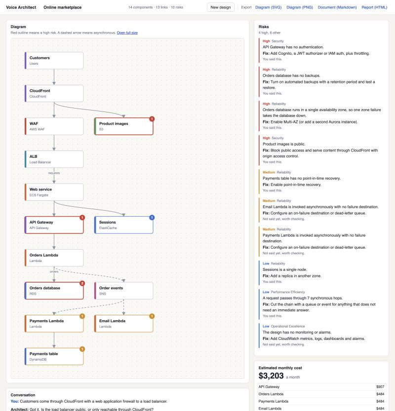

# Voice Architect

You describe a system design out loud. The program draws it, points out the risks, guesses what it would cost on AWS,
and saves a design document with the diagram in it.

It runs on your laptop. The voice is Amazon Nova 2 Sonic on Bedrock, and the tool calls go through the Strands Agents
SDK.



## Using it

```bash
./setup.sh     # first time only: audio library, Python 3.12+, packages, AWS CLI, a check
./run.sh       # opens the page and starts listening
```

Use headphones if you can. If the architect seems to hear itself, run `./run.sh --headphones`.
You need AWS access to Nova 2 Sonic in `us-east-1`. The access key is never stored in this repo.

Talk one sentence at a time and wait for the answer. Something like:

> Customers come through CloudFront to a load balancer. The load balancer sends traffic to two EC2 web servers, which
> use a Postgres database. The database runs in one availability zone and has no backups.

Things you can say after that: "what are the biggest risks", "what would this cost per month", "recap the design",
"remove the S3 bucket", "start a new design", "export the design document".

On the page you can rename the design, start a new one, or type a sentence if talking isn't convenient.

## What you get at the end

Saying "export the design document", or using the links at the top of the page, gives you:

- `exports/design-<time>/design.md`, the document with the diagram, the risks and a cost table
- `exports/design-<time>/diagram.svg`, the diagram on its own
- `exports/design-<time>/report.html`, one page with all of it that you can print to PDF
- a PNG of the diagram, from the page

## How it works

- Nova 2 Sonic listens and speaks. A Strands `BidiAgent` gives it a handful of tools.
- Everything you say about the design goes into **one tool call** (`update_design`). I started with ten small tools,
  but the model kept talking between calls and said "no new risks" before the risk check had come back.
- The risks come from plain rules in Python (`architect/rules.py`), not from the model. The next question is picked by
  code too (`architect/questions.py`), and so is the cost (`architect/costs.py`). The model is told not to add
  anything the tools didn't return.
- A fact you haven't mentioned is stored as unknown, not as false. Unknown turns into a question. Only something you
  actually said, like "no backups", turns into a risk.
- Common slips are fixed in code: "Aurora database" typed as plain RDS, "we use CloudWatch" recorded as a setting,
  "Web Server 1" and "Web Server 2" as two boxes.

## How well it works

I tested with scripted reviews: macOS `say` plays the engineer to the real model, and each run is scored against what
should have come out (components found, risks found, risks said out loud, any thinking aloud, any sentence left
unanswered).

RESULTS_TABLE

Read these numbers with some care.

- Every voice was synthetic and every scenario was cooperative. **No real person has tested it yet.**
- I fixed bugs using `store`, `pipeline` and `clean`, so those rows look better than they should. `notify` was written
  afterwards and never used for fixing, so it is the fairer row.
- "Thinking aloud" means the model talks about "the user" or its instructions, says "I should check...", or goes over
  90 words. My first detector was too broad and flagged normal answers, so I re-scored every saved round with the final
  rule (`python scripts/rescore_leaks.py`).
- Costs come from a price table I typed in from AWS's public pages. It isn't live, and the Pricing API wasn't open to the
  key I tested with. Treat the total as roughly right, give or take a quarter.

## Known problems

- A tool error can still get spoken, for example "I couldn't find Web server 2".
- It mishears service names now and then. The conversation panel shows what it heard.
- It knows 19 component types and 17 rules. No multi-region designs, no Kubernetes, not much networking detail.
- Only English has been tried.

## Tests

```bash
python -m pytest -q                                                # no AWS needed
python scripts/headless.py store pipeline --runs 4 --out out       # scripted runs against the real model
python scripts/results_table.py out/*/summary.json                 # turn the results into a table
```

## Where things are

`architect/model.py` the design, `rules.py` the checks, `questions.py` the next question, `costs.py` the estimate,
`diagram.py` the drawing, `doc.py` the exports, `tools.py` what the model can call, `agent.py` the prompt,
`live.py` the page, `session.py` ties them together, `audio_io.py` and `scoring.py` and `scenarios.py` are the test
harness.
