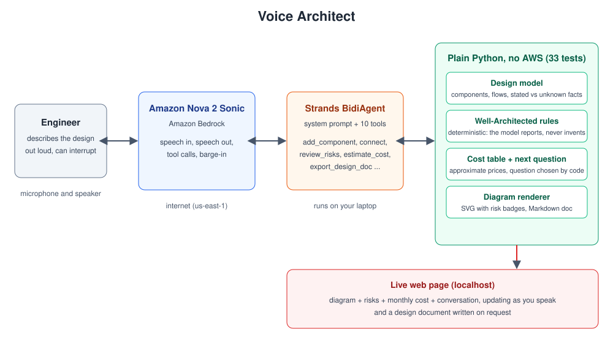

# Voice Architect

Talk through a system design out loud. An AI architect on **Amazon Nova 2 Sonic** records it as you speak, draws the
diagram live, flags Well-Architected style risks, estimates the monthly cost, asks one probing question at a time, and
writes a design document when you are done.



## What you see while you talk
A page on `http://127.0.0.1:8765` updates live: the diagram (risky components get red or amber borders and a badge
count), the risk list (each marked "stated by you" or "not stated, to confirm"), the monthly cost, and the transcript.

## How it works
- **Voice:** Amazon Nova 2 Sonic through a Strands Agents `BidiAgent`. Speech in, speech out, tool calls, barge-in.
- **One tool call per spoken sentence.** `update_design` records everything you just said (components, flows, stated
  facts, traffic) and returns the risks to state plus the single next question. Earlier versions used ten small tools and
  the model talked between calls: it said "no new risks" before the risk tool had answered.
- **The model reports, code decides.** Risks come from deterministic rules, the next question is chosen by code, and the
  cost comes from a table. The model is told never to add a risk, a question or a number a tool did not return.
- **Stated vs unknown.** A fact you did not state is `None`, not `False`. "Not stated" becomes a question; "stated" becomes
  a risk.

## Results (be honest)
Scripted design reviews: macOS `say` plays the engineer to the real model, three runs or more per scenario, scored against
ground truth (components found, risks found, risks actually spoken, thinking-aloud leaks, unanswered sentences).

| Scenario | Runs passed | Components found | Risks captured | Risks spoken | Strict leaks | Silent turns | Median reply delay |
|---|---:|---:|---:|---:|---:|---:|---:|
| store | 4 of 4 | 100% | 100% | 100% | 0 of 28 turns | 0 | 2.25 s |
| pipeline | 4 of 4 | 100% | 100% | 100% | 0 of 20 turns | 0 | 2.38 s |
| clean | 4 of 4 | 100% | 100% | 100% | 0 of 16 turns | 0 | 2.22 s |
| notify (held-out) | 4 of 4 | 100% | 100% | 100% | 0 of 16 turns | 0 | 2.36 s |


- All numbers are synthetic voices on cooperative, scripted scenarios, not real people. **Not tested by a person yet.**
- The first three scenarios (`store`, `pipeline`, `clean`) were used while fixing bugs, so they flatter the result.
  `notify` was written afterwards and never tuned against: see the held-out row.
- Leak definition: a **strict leak** is the model thinking aloud ("the user mentioned...", "I should check..."), talking
  about its instructions, or a reply over 90 words. "I need to ask..." is counted as mild narration and reported, not
  failed. The first detector was too broad (it flagged "Okay, the risk is..."); every saved round was re-scored with the
  final definition (`python scripts/rescore_leaks.py`).
- Cost: the price table is typed in from public AWS price pages, not fetched live (the Pricing API was not available to
  the test user). Expect about +-25%. The tool says so out loud.

## Known problems
- A tool error can still be spoken ("I couldn't find Web server 2, did you mean...?").
- Replies often start with "Okay,".
- Fifteen rules and eighteen component types only: no multi-region, no networking detail, no Kubernetes.
- The model sometimes needs a repeated sentence when it mishears a service name.

## Run it
```bash
./setup.sh      # first time: portaudio, Python 3.12+, packages, AWS CLI, profile 'voice-chef', pre-flight check
./run.sh        # opens the live page and starts listening (use --headphones if it hears itself)
```
Needs AWS access to Amazon Nova 2 Sonic in `us-east-1`. The key is never stored in this repo.

```bash
python -m pytest -q                                    # 51 tests, no AWS needed
python scripts/headless.py store pipeline clean --runs 4 --out out    # scripted runs against the real model
python scripts/headless.py store --live --hold 600      # same, with the live page up for screenshots
python scripts/results_table.py out/*/summary.json
```

## Layout
`architect/model.py` design + aliases, `rules.py` checks, `questions.py` next question, `costs.py` estimate,
`diagram.py` SVG, `doc.py` Markdown export, `tools.py` the tools the model sees, `agent.py` prompt and model,
`live.py` web page, `audio_io.py` scripted caller and recorder, `scoring.py` + `scenarios.py` the measurement.
